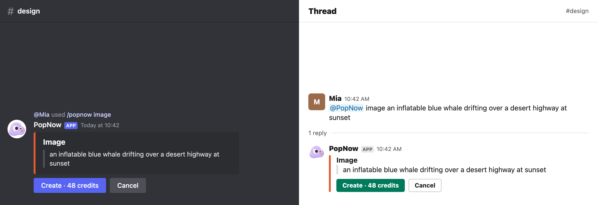
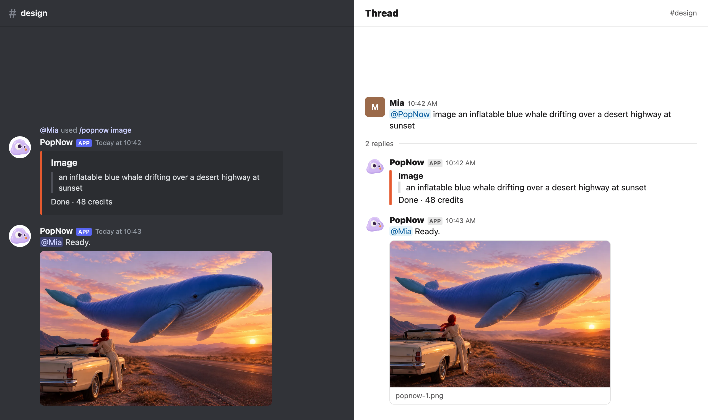

# PopNow for Discord and Slack

Make images and videos in Discord and Slack with your PopNow credits. Same account, balance and prices as [popnow.ai](https://popnow.ai).




## What people can do

| | Discord | Slack |
|---|---|---|
| Start | `/popnow image …` and the other subcommands | Mention `@PopNow` in a channel or thread, or `/popnow …` |
| Connect | First use replies, only to you, with **Connect PopNow** | First mention replies, only to you, with **Authorize** |
| Create | `image`, `video`, `edit` (photo), `animate` (photo), `effect` (photo, effect names autocomplete), `remove-bg` (photo), `upscale` (photo or video) | `image …`, `video …`, `edit <image link> …`, `animate <image link>`, `effect <name> <image link>`, `remove-bg <image link>`, `upscale <link>`; plain text is an image |
| Price | A card with **Create · N credits** and **Cancel**. Nothing is charged until you press Create. Only you can press it | Same card, in the thread |
| Result | Images attached; files over 25 MB as links | Uploaded into the same thread; files over 50 MB as links |
| Account | `balance`, `creations`, `login`, `logout` | `balance`, `creations`, `login`, `logout`, `help` |

Face swap is not offered.

## How it works

One Cloudflare Worker with two adapters (`src/discord.ts`, `src/slack.ts`), a KV namespace and a Durable Object.

- **Sign-in.** The Worker is an OAuth 2.1 public client of PopNow: discovery from `https://api.popnow.ai/.well-known/oauth-protected-resource/mcp`, dynamic registration with the redirect `https://bots.popnow.ai/oauth/callback` (the client id is kept in KV), authorization code with PKCE S256 and `resource=https://api.popnow.ai/mcp`. A **Connect** link works once and binds platform + server or workspace + user. Opening it shows a page with **Continue**; only that press (a POST) uses the link, so chat link previews can't. The callback checks `state` and `iss`.
- **Tokens** are stored in KV encrypted with AES-GCM (key: the `TOKEN_KEY` secret; the KV key is bound in as additional data). They are never logged. A 401 refreshes once. `logout` revokes the refresh and access tokens at PopNow and deletes the binding.
- **Calls** go to `https://api.popnow.ai/mcp` (Streamable HTTP; JSON and event-stream replies): `initialize`, `notifications/initialized`, `tools/call`. The tools are `estimate_cost`, `create_image`, `edit_image`, `create_video`, `apply_effect`, `remove_background`, `upscale`, `get_job`, `check_balance`, `list_my_creations`, `list_presets`, `request_upload` and `get_upload`.
- **Files from Discord** are downloaded and put into an upload window (`request_upload` → `/console/v1/upload-sessions/<token>/files` → signed PUT without Authorization → commit → close → `get_upload`), then passed as `popnow://` links. Slack mentions take image links (https or popnow://), so the app needs no `files:read`.
- **Quote, then start.** Each request gets a Durable Object named after its short quote id:
  1. It prices with `estimate_cost`, which is free and creates nothing, then shows the card.
  2. **Create** starts the tool with `max_credits` set to exactly the button price. The object runs one press at a time, so pressing twice still starts one job.
  3. If the price went up, nothing starts. The card shows the new price and the old buttons stop working.
  4. If PopNow asks for consent, the card shows **I confirm**, and only the person who asked can press it.
  5. An alarm polls `get_job` and posts the result when it is ready.
  Button ids carry only `pn:<action>:<quote>:<rev>`. Quotes expire after 30 minutes.
- **Slack** gets an answer within 3 seconds; the work runs in `ctx.waitUntil` and the Durable Object. Events are deduplicated by `event_id`, and requests with `X-Slack-Retry-Num` get a plain 200. Signatures use v0 HMAC with a 5-minute window. **Discord** uses Ed25519 signatures with the same 5-minute window and a deferred reply plus follow-ups. When the 15-minute interaction token has expired, it posts with the bot token.

KV keys: `oauth:client`, `bind:*` (15 min), `state:*` (10 min), `link:<platform>:<workspace>:<user>` (sealed), `quote:*` (1 day), `dedupe:*` (1 day), `presets:effects` (1 day), `slack:team:*` (sealed bot tokens), `slack:install:*` (10 min).

## Setup

1. **KV.** Run `npx wrangler kv namespace create DATA` and put the id in `wrangler.toml`.
2. **Discord.** Create an application at <https://discord.com/developers/applications>:
   - Interactions Endpoint URL: `https://bots.popnow.ai/discord/interactions`
   - Installation: guild install and user install, scopes `applications.commands` and `bot`
   - Put the application id in `wrangler.toml` (`DISCORD_APPLICATION_ID`)
   - Register the command:
     ```sh
     DISCORD_APPLICATION_ID=… DISCORD_BOT_TOKEN=… node scripts/register-discord-commands.mjs
     ```
     Add `DISCORD_GUILD_ID=…` to register it in one server for testing.
3. **Slack.** Create the app from `slack/manifest.yaml` at <https://api.slack.com/apps> and put the client id in `wrangler.toml` (`SLACK_CLIENT_ID`).
   - Bot scopes: `app_mentions:read`, `chat:write`, `commands`, `files:write`, `im:write`.
   - Workspaces install it from `https://bots.popnow.ai/slack/install`.
4. **Secrets.** Set each with `npx wrangler secret put <NAME>`:

   | Secret | What |
   |---|---|
   | `TOKEN_KEY` | 32 random bytes, base64 (`openssl rand -base64 32`). Encrypts PopNow tokens. Changing it disconnects everyone. |
   | `DISCORD_PUBLIC_KEY` | Discord application public key (hex) |
   | `DISCORD_BOT_TOKEN` | Discord bot token |
   | `SLACK_SIGNING_SECRET` | Slack signing secret |
   | `SLACK_CLIENT_SECRET` | Slack client secret (workspace installs) |
   | `SLACK_BOT_TOKEN` | Optional: a bot token for a single workspace without the install flow |

5. **Deploy.** Run `npx wrangler deploy`. The route is the custom domain `bots.popnow.ai`; don't use the `files.` or `hooks.` subdomains.

## Development

```sh
npm install
npm run typecheck
npm test          # fake PopNow server on 127.0.0.1, in-memory KV and Durable Objects, recorded Discord/Slack calls
npm run build     # wrangler deploy --dry-run --outdir dist
```

For `wrangler dev`, put the secrets in `.dev.vars` (ignored by git).

## License

MIT
